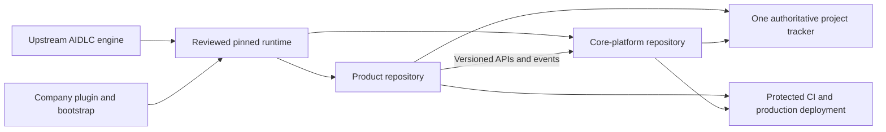

# Company extension design and ordered rollout

## Inspection and decision

Inspected the fork and upstream on 2026-11-01. The fork's `main` was
`3939a8b9182f2e4153b92028057a7be74e0684c2`; upstream was
`c8ed1a7a3ee9dbd87447d0e4c544cbce2d4fb523`, one commit ahead. The difference
is Kiro IDE plugin SessionStart timeout registration (#3369). This extension is
based on the fork's head; upstream synchronization is a separate review.

The upstream is already a substantial multi-harness implementation: core stages,
knowledge, rules, deterministic lifecycle tooling, seven harness projections,
plugin validation/build/composition, and team/project practices. Reuse it.
Do not create another orchestration layer or copy its generated distributions.
The additive ownership decision is recorded in
[ADR 0001](adr/0001-additive-company-extension.md).

Evidence:
- [Fork baseline](https://github.com/hamzaehsan97/aidlc-workflows/tree/3939a8b9182f2e4153b92028057a7be74e0684c2)
- [Observed upstream change](https://github.com/awslabs/aidlc-workflows/commit/c8ed1a7a3ee9dbd87447d0e4c544cbce2d4fb523)
- [Plugin seam and limitations](../docs/harness-engineering/10-authoring-a-plugin.md)
- [Team knowledge](../docs/harness-engineering/07-team-knowledge.md)
- [Rule ownership and affirmation](../docs/harness-engineering/05-rules-and-the-loop.md)

## Ownership and execution

`company/` owns adoption instructions, templates, process ADRs, portable skills and
bootstrap. `plugins/company-saas/` owns shared policy knowledge and six additive
stage fragments. Existing core/harness/tooling files remain untouched. A small
README entry makes the fork's company entry point visible; a separate company
workflow validates its owned content. The [file inventory](files.md) names all
files exactly.

| Requested capability | Implemented foundation | Remaining adoption work |
| --- | --- | --- |
| Shared engineering standards | Tenant/security/test/ownership/ADR baseline; practices-discovery contribution | Select stack/owners; affirm applicable rules per repo |
| Reusable AI skills | Discovery, contract review, work-item sync | Live host invocation and a real task pilot |
| ADRs | Extension ADR and product ADR template | Accept architecture choices in platform/product repos |
| Discovery/validation | Research and handoff contributions + experiment brief | Choose first segment; gather real evidence |
| MCP/project management | Provider-neutral record/write/recovery contract + GitHub setup guidance | Select actual project, authenticate and verify read/write capabilities |
| Repo bootstrap | Preview/write, provenance, conflict checks, owned profile and skills | Bootstrap first real product and platform repo on branches |
| Secure production gates | Enforcement matrix, negative tests and release-evidence template | Configure branch/environment/IAM controls in application repos; demonstrate denials |
| Platform architecture | Ownership boundaries and minimum contract obligations | Implement/publish versioned contracts and one consumer |

## Ordered milestones

Effort ranges are planning estimates for a small team, not delivery commitments.
The first product's evidence, risk and chosen stack determine the actual duration.

1. **Review and pilot the foundation (1–2 engineer-days).** Review this draft PR,
   name the engineering owner, accept ADR 0001 and pin the company/engine commits.
   Run deterministic checks, bootstrap a disposable repo, compose the plugin and
   invoke all three skills in the chosen host. Exit: no composition drops, usable
   outputs, deliberate ownership and a tested rollback. This PR implements the
   foundation; it does not mark adoption or ADR acceptance complete.
2. **Validate one product (roughly 1–2 calendar weeks).** Product owner chooses one
   buyer/job and timeboxes interviews/prototype/pilot. Agree thresholds before
   testing, retain evidence privately, and record proceed/pivot/defer/stop. Exit:
   an explicit investment decision and one narrow outcome worth implementing.
   Do this before a broad shared-platform build.
3. **Connect the delivery system (about 1 day after project selection).** Engineering
   lead selects GitHub Projects or the existing tracker, completes the local profile
   and verifies read-only access. Exercise an authorized create/update/link operation
   against a test work item, including duplicate/timeout/conflict recovery. Exit:
   one authoritative backlog, traceable PR links and no false Done transitions.
4. **Build the platform walking skeleton (roughly 3–5 engineer-days, then revise).**
   Choose stack/hosting in an ADR. Create the separate platform repo, managed identity,
   tenant/membership boundary, minimal product registration and entitlement contract;
   connect one product's login-to-first-value journey. Add billing only as the pilot
   requires; defer broad ticketing and employee tooling to integrations. Exit:
   two-tenant isolation tests and producer/consumer contract tests pass.
5. **Prove production controls before the paid pilot (roughly 2–4 engineer-days).**
   Operations owner configures current-commit CI, branch review, protected deployment,
   scoped OIDC/IAM, monitoring, backups and recovery. Verify plan availability and
   run the negative tests in the production guide. Exit: recorded denials, restore
   drill, candidate-bound approval and an observed successful staging journey.
6. **Launch, measure and replicate (after the pilot observation window).** Compare
   repeated use, conversion, support cost and unit economics to the discovery brief.
   Keep/pivot/stop product one. Only then bootstrap product two, extract proven common
   clients, and consider moving the company pack into its own release repository.
   Exit: a second consumer uses the same pinned practices and versioned contracts
   without product-specific engine edits.

## Upstream maintenance

Keep company changes in their owned paths and one small root README entry. Fetch
upstream regularly; open a separate synchronization branch/PR from the fork's main.
Review the core delta, especially stage anchors, knowledge paths, plugin schema and
packaging behavior. Regenerate, validate, test composition/disable and run the normal
upstream checks. Never auto-resolve engine conflicts or rewrite release metadata.
Update `company/upstream.json` only with the reviewed compatibility evidence.

Pin tested company and engine commits per consumer; do not pull mutable main into
production builds. Recompose after runtime updates, check doctor, and pilot the
new pair in one repo before portfolio-wide rollout. Roll back the consumer's
snapshot and runtime together. Keep customizations in the company source or
explicit product rules rather than editing generated files. A future standalone
company repo can preserve the same plugin layout without changing engine ownership.

## Open decisions and limits

Company identity, first market, application stack/cloud, tracker project, reviewers
and platform repository URL are intentionally unset. The referenced conversation
suggested shared billing, tickets, employee onboarding and a client gateway; it
did not supply accepted detailed architecture or accessible assistant answers.
This proposal does not assume those missing decisions or invent product validation.

Deterministic composition is distinct from live host behavior. Production policy
is distinct from configured enforcement. MCP guidance is distinct from an account
connection. No runtime application, cloud resource, credentials or live deployment
is created by this extension. See the PR validation report for actual test results.
